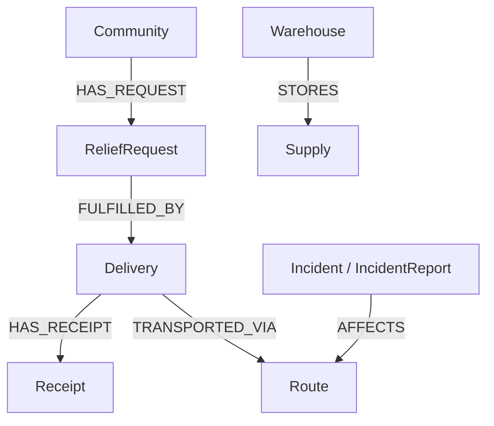
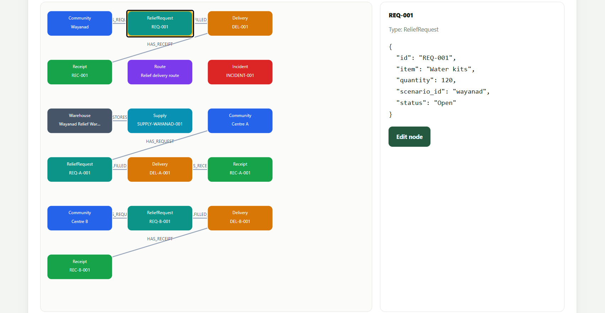

# AidTrace — Relief Investigation System

AidTrace is a graph-powered relief investigation system that helps identify discrepancies in disaster-relief distribution, trace resources across connected records, investigate missing evidence, and understand potential supply-chain irregularities.

Built with **Python, Flask, FalkorDB, Cypher, and Google Gemini**, AidTrace connects relief requests, deliveries, receipts, routes, communities, warehouses, and supplies into a graph that investigators can explore.

## Features

- **Graph-based investigation:** Trace connected relief records and identify potential discrepancies.
- **Evidence tracing:** Explore relationships between requests, deliveries, receipts, and routes.
- **Cross-centre investigation:** Examine potential inconsistencies across relief distribution centres.
- **Resource matching:** Help identify relief resources and distribution needs.
- **Interactive graph explorer:** Inspect graph nodes and their relationships.
- **Route updates:** Update route information with a recorded reason.
- **Node updates:** Edit supported graph properties with a reason for the change.
- **AI-assisted investigation:** Use Google Gemini to explain findings based on investigation evidence.
- **Multiple scenarios:** Explore the Wayanad and Assam flood-relief scenarios.

## Project Demo Video

Watch me explain the project, its motivation, graph-based investigation approach, and demonstration workflow.

**[▶ Watch the AidTrace Project Explanation on YouTube](https://youtu.be/Er1qoUYxt-c)**

## Technology Stack

- **Backend:** Python, Flask
- **Graph database:** FalkorDB
- **Graph queries:** Cypher
- **AI:** Google Gemini API
- **Frontend:** HTML, CSS, JavaScript

## Architecture

AidTrace combines graph-based data retrieval and investigation logic with AI-assisted explanations.

1. **Graph storage:** Relief-distribution records are stored as connected nodes and relationships in FalkorDB.
2. **Graph investigation:** The Flask backend executes Cypher queries to retrieve connected records, trace evidence, and examine potential discrepancies.
3. **Evidence analysis:** Investigation logic processes the retrieved graph data to identify relevant discrepancies and relationships.
4. **Dashboard:** The application presents investigation findings, resource information, and graph relationships.
5. **AI-assisted explanation:** Google Gemini receives investigation evidence to help explain findings and distinguish potential discrepancies from confirmed facts.

Deterministic graph queries handle underlying data retrieval and investigation logic, while AI provides additional explanations. AI-generated explanations should be interpreted in the context of the available evidence.

## Graph Data Model

AidTrace represents relief-distribution information as a graph, connecting related records so investigations can trace relief requests, deliveries, receipt evidence, routes, incidents, warehouses, and supplies. The records and connections present can vary by scenario and by application operations.

### Core node categories

| Node label                    | Purpose                                                                                                                         |
| ----------------------------- | ------------------------------------------------------------------------------------------------------------------------------- |
| `Community`                   | Represents communities affected by a disaster or relief-distribution centres.                                                   |
| `ReliefRequest`               | Records requested relief resources, quantities, and request status.                                                             |
| `Delivery`                    | Represents delivery records, including reported quantities and delivery status.                                                 |
| `Receipt`                     | Records receipt evidence, including confirmed quantities and confirmation status.                                               |
| `Route`                       | Represents delivery routes and their associated status.                                                                         |
| `Incident` / `IncidentReport` | Represents reported incidents relevant to an investigation. The seed script assigns both labels to the Wayanad incident record. |
| `Warehouse`                   | Represents relief-resource storage and distribution locations.                                                                  |
| `Supply`                      | Records relief resources and their quantities associated with a warehouse.                                                      |
| `AuditLog`                    | Represents an audit record displayed in the graph explorer when a supported change is recorded.                                 |

### Graph relationship overview

The diagram below shows the primary relationships explicitly created by `seed_graph.py`. It is a general overview of the seeded graph structure, not a promise that every scenario contains every node or connection.



### Example: Wayanad Scenario Graph

The screenshot below shows AidTrace's graph explorer displaying the Wayanad demonstration scenario. It illustrates connected communities, relief requests, deliveries, receipts, routes, incident reports, warehouses, and supplies. Selecting a node reveals its stored properties, allowing users to inspect records and trace related evidence across the graph.

The displayed records are synthetic demonstration data used to illustrate how AidTrace connects relief-distribution information for investigation.



### How the graph supports investigations

AidTrace connects relief requests to delivery records and receipt evidence, allowing the application to compare reported quantities with confirmed quantities. For example, the synthetic Wayanad demonstration records 120 water kits as reported delivered and 70 as confirmed by receipt evidence, leaving a discrepancy of 50 kits that requires further verification.

The graph also connects delivery records to routes and incident reports, while warehouses are connected to their supplies. These relationships allow related records to be retrieved together instead of being treated as isolated entries. The graph explorer may display additional application records, such as audit logs.

The Wayanad and Assam scenarios contain synthetic demonstration data. A discrepancy or unverified incident is an investigation lead, not proof of fraud. The diagram documents the primary relationships created by the seed script; additional queries or application operations may use other graph operations.

### Why a graph database?

A relief-distribution discrepancy may involve several connected records. For example, a delivery record may be associated with a relief request, a route, and a receipt. Other available records, such as warehouse supplies or incident reports, can provide additional context when connected in the graph.

Investigating these connections allows AidTrace to examine the surrounding evidence rather than relying on an isolated quantity or record. It can help investigators identify inconsistencies, trace related records, and determine which findings need further verification.

## How FalkorDB Powers Investigations

FalkorDB is a core component of AidTrace's investigation workflow, not simply a storage layer.

The application uses Cypher queries to retrieve connected records and investigate relationships in the `aidtrace` graph.

The workflow is:

1. Select a demonstration scenario, such as Wayanad or Assam.
2. Query FalkorDB for relevant relief records and their connections.
3. Examine the retrieved evidence for potential discrepancies and related records.
4. Present investigation findings through the dashboard and graph explorer.
5. Pass the available investigation evidence to Google Gemini for an additional explanation when AI-assisted investigation is requested.

This separation allows graph queries to retrieve the underlying records while the AI layer helps communicate what the available evidence may indicate.

### Example investigation scenario

In the Wayanad demonstration, 120 water kits are reported as delivered, while records account for only 70 kits.

The resulting difference is:

**Reported quantity − Accounted quantity = Potential discrepancy**

**120 − 70 = 50 kits**

AidTrace uses this scenario to demonstrate how an investigator can examine the reported quantities and trace related records to understand the discrepancy.

The difference alone does not establish that supplies were stolen or diverted. The underlying delivery records, receipts, and other available evidence must be examined before drawing conclusions.

### Cypher queries and investigation logic

AidTrace uses Cypher to retrieve and examine graph records. Its investigation and graph-exploration modules query FalkorDB to support evidence tracing, cross-centre checks, resource matching, and graph visualization.

For implementation details and the project's Cypher queries, see [Cypher Queries and Graph Algorithms](docs/CYPHER_QUERIES.md).

The graph schema and query examples in the documentation should be read alongside the actual implementation in `seed_graph.py`, `investigation.py`, `investigate.py`, and `graph_explorer.py`.

## Prerequisites

Install the following before running AidTrace:

- Python 3.10 or later
- Git
- Docker Desktop or Docker Engine
- A Google Gemini API key for AI-assisted investigation

## Installation and Setup

### 1. Clone the repository

```bash
git clone https://github.com/YADHUKISHANTR/AidTrace.git
cd AidTrace
```

### 2. Start FalkorDB

Run FalkorDB using Docker:

```bash
docker run -d \
  --name aidtrace-db \
  -p 6379:6379 \
  -p 3000:3000 \
  -v aidtrace_data:/var/lib/falkordb/data \
  falkordb/falkordb:latest
```

If the container already exists, start it with:

```bash
docker start aidtrace-db
```

The application connects to FalkorDB at `localhost:6379` and uses the graph named `aidtrace`.

FalkorDB's browser interface is available at:

```text
http://localhost:3000
```

### 3. Create a Python virtual environment

**Windows PowerShell**

```powershell
python -m venv .venv
.\.venv\Scripts\Activate.ps1
```

**Windows Command Prompt**

```cmd
python -m venv .venv
.venv\Scripts\activate.bat
```

**Linux or macOS**

```bash
python3 -m venv .venv
source .venv/bin/activate
```

### 4. Install dependencies

```bash
python -m pip install --upgrade pip
pip install -r requirements.txt
```

### 5. Configure the environment

Create a file named `.env` in the project root:

```env
GEMINI_API_KEY=your_gemini_api_key
```

Replace the example value with your own Google Gemini API key.

Keep `.env` private and do not commit API keys to GitHub.

### 6. Initialize the graph data

AidTrace uses `seed_graph.py` to populate FalkorDB with sample disaster-relief data for the Wayanad and Assam scenarios. The script creates the graph nodes and relationships used by the investigation system.

Make sure FalkorDB is running before executing:

```bash
python seed_graph.py
```

Run this command when setting up the sample data for the first time. You do not need to run it every time you start the website if the data is already present.

### 7. Run the application

```bash
python app.py
```

Open the local dashboard in your browser:

```text
http://127.0.0.1:5000/
```

Keep the FalkorDB container running while using the application.

## Using AidTrace

1. Open the dashboard.
2. Select the Wayanad or Assam scenario.
3. Run an investigation to examine the connected relief records.
4. Review discrepancies, evidence, resource information, and investigation findings.
5. Explore the graph to inspect relationships between records.
6. Use supported route and node updates to record justified changes.
7. Run the AI-assisted investigation to obtain an additional explanation of the available evidence.

The scenarios use sample data for demonstration. Investigation findings indicate potential discrepancies that require verification; they do not, by themselves, establish fraud or wrongdoing.

## Project Structure

```text
AidTrace/
├── static/                  # Frontend assets
├── templates/               # Flask HTML templates
├── tests/                   # Tests
├── app.py                   # Flask application
├── seed_graph.py             # Graph data initialization
├── investigate.py            # Investigation logic
├── investigation.py          # Investigation functionality
├── investigation_report.py   # Investigation reporting
├── ai_investigator.py        # Gemini-assisted investigation
├── trace_evidence.py         # Evidence tracing
├── graph_explorer.py         # Graph exploration
├── check_cross_centre.py     # Cross-centre checks
├── add_evidence.py           # Evidence utilities
├── rename_location.py        # Location utilities
└── requirements.txt          # Python dependencies
```

## AI Disclosure

ChatGPT was used to assist with project development, debugging, and documentation. Google Gemini is integrated into AidTrace to provide AI-assisted explanations of investigation findings. The project author reviewed the AI-assisted development contributions.

All AI tools used were accessed through their free tiers. 

No paid AI subscriptions, premium plans, or paid AI API usage were used during development. The project implementation, integration, testing, and final decisions were carried out and reviewed by me.

## Track

**FalkorDB Graph Hacks — Track 01: Agents That Act on Connected Data**

AidTrace applies graph-based investigation to disaster-relief distribution, using connected evidence to identify potential discrepancies and support explainable investigation workflows.
